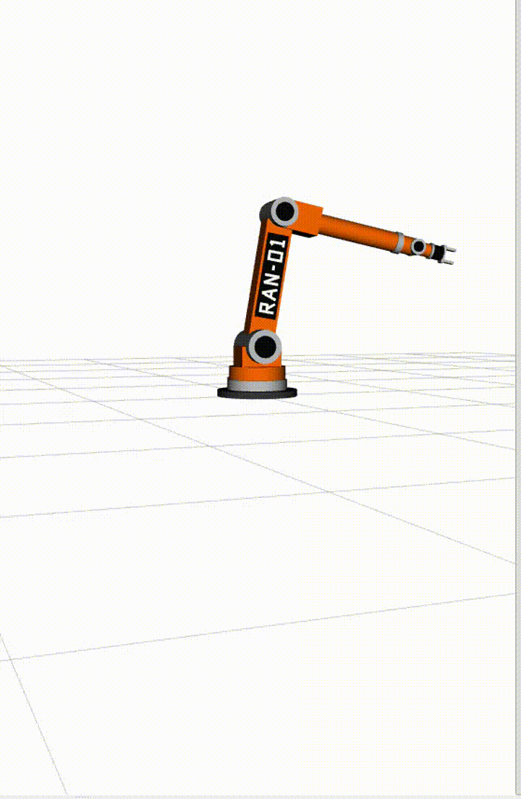

# RAN-01: a 6-DOF Robot Arm in ROS Noetic

An industrial-style 6-joint robot arm, built entirely from simple shapes in URDF/xacro, visualised in RViz, controlled with joint sliders, and recorded/replayed with rosbag. Runs on modern Ubuntu (22.04 / 24.04) through a ROS Noetic Docker container.



## What's inside

- **Robot model** (`urdf/robotarm.urdf.xacro`): `base_link` plus 6 revolute joints ending in `tool0`, about 1.8 m of reach from the shoulder.
  - Industrial look from primitives only: orange body, steel motor hubs with black end caps, a cable box on the base and a two-finger gripper.
  - The **RAN-01** name runs along both sides of the upper arm, drawn from thin boxes (one per letter stroke) and mirrored on the far side so it reads correctly from both directions.
  - Every link has visual and collision geometry; collisions stay simple (one box or cylinder per link).
- **Live simulation** (`launch/simulate_arm.launch`): loads the model, starts `robot_state_publisher`, the `joint_state_publisher_gui` sliders and RViz.
- **Replay** (`launch/rosbag_support.launch`): replays recorded `/joint_states` with simulated time, so RViz shows the arm move exactly as recorded.

```
sliders ──/joint_states──▶ robot_state_publisher ──TF──▶ RViz
rosbag  ──/joint_states──▶ (same pipeline, with /clock)
```

## Repository structure

```
ros-noetic-robot-arm/
├── README.md
├── LICENSE
├── docker/
│   └── run_noetic.sh          # starts the ROS Noetic container with GUI support
├── docs/
│   └── demo.gif
└── workspace_experiments/     # the ROS package (goes into catkin_ws/src)
    ├── CMakeLists.txt
    ├── package.xml
    ├── urdf/robotarm.urdf.xacro
    ├── launch/simulate_arm.launch
    ├── launch/rosbag_support.launch
    └── config/arm.rviz
```

## Quick start

### 1. Get ROS Noetic

On **Ubuntu 20.04** you can install ROS Noetic natively ([official guide](http://wiki.ros.org/noetic/Installation/Ubuntu)).

On **Ubuntu 22.04 / 24.04**, use Docker:

```bash
sudo apt install -y docker.io x11-xserver-utils
sudo usermod -aG docker $USER      # then log out and back in
docker pull osrf/ros:noetic-desktop-full
```

### 2. Clone into a catkin workspace

```bash
mkdir -p ~/catkin_ws/src
cd ~/catkin_ws/src
git clone https://github.com/rahmatullahhaqnawaz/ros-noetic-robot-arm.git
```

### 3. Start the container (Docker users)

```bash
bash ~/catkin_ws/src/ros-noetic-robot-arm/docker/run_noetic.sh
```

Inside the container, install the extra packages once:

```bash
apt update
apt install -y ros-noetic-joint-state-publisher-gui liburdfdom-tools
echo "source /opt/ros/noetic/setup.bash" >> ~/.bashrc
source ~/.bashrc
```

### 4. Build

```bash
cd ~/catkin_ws
catkin_make
source devel/setup.bash
```

### 5. Run

```bash
roslaunch workspace_experiments simulate_arm.launch
```

Move the sliders and the arm follows in RViz. To see where the tool is, open a second terminal (`docker exec -it noetic bash`) and run:

```bash
rosrun tf tf_echo base_link tool0
```

## Demo mode

Watch RAN-01 move by itself through a looping choreography (no sliders needed):

```bash
roslaunch workspace_experiments demo.launch            # normal speed
roslaunch workspace_experiments demo.launch speed:=0.6 # slower, nicer for recording
```

The node `scripts/demo_motion.py` publishes `/joint_states` and moves smoothly between keyframes (cosine easing). Add or change poses in its `KEYFRAMES` list.

## Record and replay a motion

```bash
# terminal 2, while simulate_arm.launch is running
cd ~/catkin_ws/src/ros-noetic-robot-arm/workspace_experiments
mkdir -p data && cd data
rosbag record -O arm_motion.bag /joint_states
# drag the sliders, then Ctrl+C

rosbag info arm_motion.bag
```

Replay (stop `simulate_arm.launch` first):

```bash
# terminal 1
roslaunch workspace_experiments rosbag_support.launch
# terminal 2
rosbag play --clock arm_motion.bag
```

`use_sim_time` plus `--clock` make every node use the recorded time, so the TF timestamps line up and RViz replays the motion.

## Troubleshooting

| Problem | Fix |
| --- | --- |
| `permission denied ... docker.sock` | You're not in the `docker` group yet: log out and back in, or reboot. |
| RViz crashes with `MESA-LOADER` / segmentation fault | `export LIBGL_ALWAYS_SOFTWARE=1` (already set by `run_noetic.sh`). |
| `could not connect to display` | Run `xhost +local:docker` on the host before starting the container. |
| `CMakeCache.txt directory ... is different` | `rm -rf build devel` and run `catkin_make` again (only build inside the container). |
| RViz shows `Unknown frame map` | Set *Fixed Frame* to `base_link`. |

## Built with

ROS Noetic · URDF / xacro · robot_state_publisher · joint_state_publisher_gui · RViz · rosbag · Docker

## Team

- Rehmatullah Haq Nawaz ([GitHub](https://github.com/rahmatullahhaqnawaz) · [LinkedIn](https://linkedin.com/in/rehmatullah-haqnawaz))
- Niko
- Alex

Built as students at Constructor University Bremen.

## License

MIT, see [LICENSE](LICENSE).
